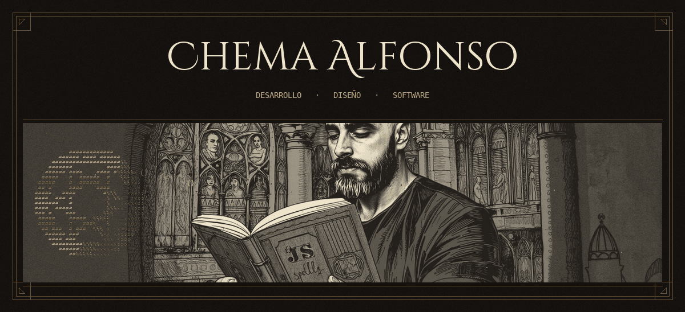
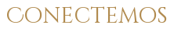
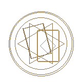
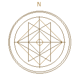
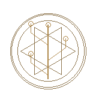
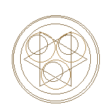
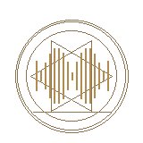
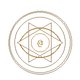
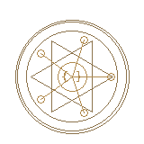

 &nbsp; · &nbsp;  &nbsp; · &nbsp;  &nbsp; · &nbsp; 

## Sobre mí

Soy **Chema Alfonso**, desarrollador y diseñador de software. A los **12 años** hice mi primera página web personal. Desde entonces he seguido aprendiendo y construyendo, a veces a través de la formación y otras siguiendo una pregunta hasta encontrar cómo resolverla.

He aprendido mucho de forma **autodidacta**, entre cursos, documentación e investigación propia. También cursé **DAW** en [Igformacion](https://igformacion.com) y un **Experto universitario en análisis y diseño de software** en la [UCAM](https://www.ucam.edu).

Soy cofundador de **[Paagees](https://www.paagees.com)**, mi empresa, donde creamos sitios web para agencias inmobiliarias. Un producto en el que el desarrollo, el diseño y la atención a los detalles van de la mano.

También formo parte del equipo de **[Sooprema](https://www.sooprema.com)**, donde trabajamos en software para el sector inmobiliario. Y a través de **[Kraken Labs Web](https://krakenlabsweb.com)** ofrezco mis servicios de desarrollo y diseño de software.

Sigo explorando herramientas y formas de construir. En estos repositorios conviven interfaces, automatizaciones, experimentos con IA y soluciones para necesidades concretas.

## Repositorios

### 

Cartas para One Page Rules a partir de ejércitos de Army Forge, con ilustraciones por IA y exportación a doble cara para imprimir.

 

### 

Una PWA para repartidores en zonas de campo y diseminados, pensada para funcionar también sin conexión.

 

### 

Una herramienta para explorar la actividad de desarrollo a través de los commits, con ayuda de IA.

 

### 

Una pequeña biblioteca para construir interfaces neumórficas: volumen, luces y sombras llevados al navegador.

 

### 

Una herramienta para generar índices de contenido a partir de vídeos y archivos de audio usando IA.

 

### 

Imágenes, vídeos y cámara convertidos en caracteres.

 

### 

Una plataforma para crear y gestionar chatbots con IA en distintos servicios de mensajería, con comportamientos globales y por usuario.

 

## Mis redes

 
 
 
 

## Conectemos

Si quieres hablar sobre un proyecto, colaborar o simplemente intercambiar ideas, puedes encontrarme en mis redes o escribirme a **[hola@chemaalfonso.com](mailto:hola@chemaalfonso.com)**.

<i>“Cuanto más grande es la prueba, más glorioso es el triunfo.” — Thomas Paine</i>

